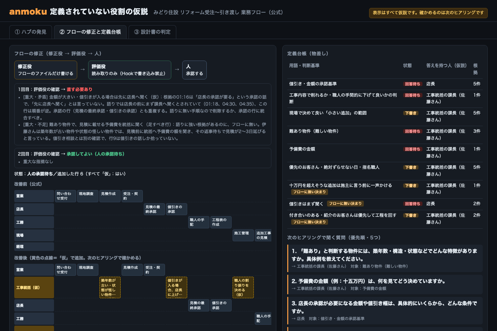
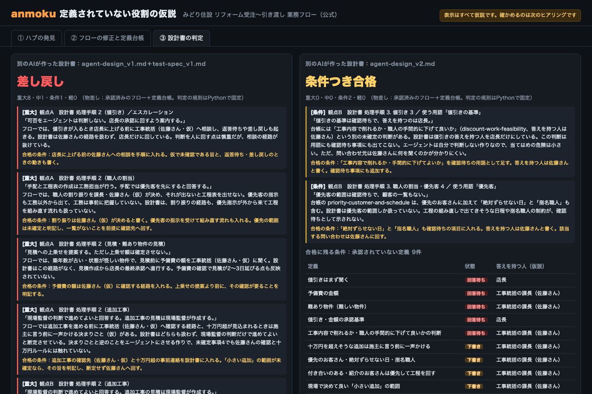
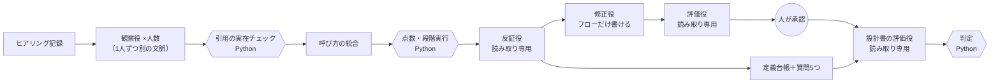

# anmoku（暗黙）

**ヒアリングの語りから、業務フローに定義されていない役割を見つけ、その人の判断を引き継げる形にする。**
見つけた物差し（定義台帳）で、別のAIが作ったエージェント設計書を、作る前に評価する。

> Built with Claude: Japan 2026 の期間中（2026-11-02〜11-08）に新しく作ったツールです。テーマ1「あなたにしかない深さを。」で応募しています。
> 表示はすべて**仮説**です。確かめるのは、人が行う次のヒアリングです。


## なぜ作ったか

業務改善の仕事で、ある会社の業務を現場の語りから業務フローにし、約30件の課題を洗い出しました。
その中で、**フローのどこにも定義されていない1人の統括者**に問い合わせが集中し、返事待ちが全体を遅らせていることが分かりました。
ただ、それに気づいたのは分析の終盤でした。最初のヒアリングの段階で気づけていれば、もっと早く手を打てたはずです。

AIエージェントを作るときも同じことが起きます。フローに無い役割と、その人の頭の中にしかない判断基準は、設計書にも載りません。
anmoku は、それを**ヒアリングの段階で、検証できる根拠つきで**見つけるための道具です。

## 何をするか

| | 入力 | anmoku がすること | 出力 |
|---|---|---|---|
| **関門1：業務フロー** | 複数人のヒアリング記録、業務フロー | 評価＋修正 | ①ハブの仮説（点数の内訳と根拠の引用つき）②次に聞く質問5つ ③「仮」の印つき修正版フロー |
| **物差し** | ヒアリング記録 | 作成・管理 | ④定義台帳（下書き → 回答待ち → 承認済み） |
| **関門2：設計書** | 別のAIが作った設計書・テスト仕様 | 評価だけ（直すのは設計役） | 合格／条件つき合格／差し戻しと、合格の条件 |

デモ用の架空の会社（住宅リフォーム会社「みどり住設」）では、工事統括の佐藤課長がどのレーンにもいません。
語り手は「課長」「佐藤さん」「統括」とばらばらに呼び、経理の山本課長も「課長」と呼ばれます。

### 画面（`anmoku-out/index.html`）

- **① ハブの発見**：「ヒアリング記録を読み込む」でヒアリングした人が並び、人を選ぶと記録の全文が読める（分析中の段階で根拠に使った行には印が付く）。読み込みと分析はコマンドで済ませてあり、ボタンはその記録を画面に並べるもの。「次の人を追加」でヒアリングを1人ずつ足すと、別名がまとまり、点数が跳ね上がる様子が見える。根拠の引用と反証役の確認つき
- **② フローの修正と定義台帳**：修正役 → 評価役 → 人の往復、改善前後のフロー（「仮」の行は黄色の点線）、定義台帳、質問5つ
- **③ 設計書の判定**：1版目は差し戻し、評価結果を設計役に渡して直した2版目は条件つき合格。残る条件は「答えを持つ人の回答待ち」

| ② フローの修正と定義台帳 | ③ 設計書の判定 |
|---|---|
|  |  |

画面の例（1回の実行結果を固定したもの。フローは人の承認待ちで、設計書の評価は修正版を承認したものとして扱って行った）：[`docs/demo/index.html`](docs/demo/index.html)（ダウンロードしてブラウザで開く）

## しくみ

詳しくは [docs/architecture.md](docs/architecture.md)。



原則：

1. **LLM は原文の引用つきの観察だけを書く**。引用は原文と文字列で照合し、無いものは捨てる。点数・照合・判定・図は、同じ入力なら同じ結果になる Python で作る
2. **役割を権限で分ける**。評価役は読み取りツールしか持たず、修正役はフローのファイルにしか書けない。どちらも Hook（`hooks/guard_write.py`）で機械的に止める
3. **評価役には、作った側の会話を渡さない**。フローの評価役には修正版と語りだけ、設計書の評価役には設計書と物差しだけを渡す
4. **検知結果はすべて仮説**。確定させるのは人が行う次のヒアリング。結論は「役割を定義し、支える」方向にそろえる

### 点数（説明できる式）

```
点数 = フローに無い度合い ×（話した人数×2 ＋ 確認・相談・承認・判断・差し戻しの件数 ＋ 待ちの件数×1.5）
```

- フローに無い度合い：レーンがある＝0、タスク名にだけ出てくる＝0.5、どこにも無い＝1
- 「ハブの仮説」と呼ぶのは、フローに無く、**2人以上の語りに出て**、1位の半分以上の点数のものだけ（1人の語りだけなら「候補」）
- 役職名だけの呼び方（「課長」など）は、フローの担当欄との照合に使わない（経理の山本課長に当たってしまうため）

### 設計書の判定（Python で固定）

- 重大が1件でもあれば **差し戻し**
- 中・条件、または承認されていない定義に頼る部分が残るあいだは **条件つき合格** まで
- 承認されていない定義を、未確定と書かずにエージェントが自分で当てはめる作りは重大。未確定と明記して人に回していれば「条件」

## 使い方

必要なもの：[Claude Code](https://claude.com/claude-code)（`claude` コマンド）、[uv](https://docs.astral.sh/uv/)、Python 3.12 以上。

### Claude Code のプラグインとして

```
/plugin install anmoku --marketplace chisuke0309/anmoku
```

（古い Claude Code では `/plugin marketplace add chisuke0309/anmoku` のあと `/plugin install anmoku@anmoku`）

導入後、「このヒアリング記録を anmoku で分析して」のように頼むと、Skill が手順に沿って進めます（候補の確認とフローの承認は、利用者に確かめてから進みます）。

### コマンドとして

```bash
git clone https://github.com/chisuke0309/anmoku && cd anmoku
uv sync

# デモの会社で、関門1 → 定義台帳 → フロー修正 → 設計書の評価 まで
# （--approve-flow は、修正版フローを人の承認なしに「承認したものとして扱う」評価・デモ用の指定。画面にもそう表示する）
uv run anmoku run evals/scenarios/basic --approve-flow \
  --design agent-design_v1.md agent-design_v2.md --test test-spec_v1.md
open evals/scenarios/basic/anmoku-out/index.html
```

| コマンド | 中身 |
|---|---|
| `anmoku detect <案件>` | 関門1：ハブの検知（1人ずつ段階実行・反証役） |
| `anmoku ledger <案件>` | 定義台帳と、答えを持つ人への質問5つ |
| `anmoku fix <案件>` | 修正役 → 評価役の往復（最大2回） |
| `anmoku approve-flow <案件>` | 人が修正版フローを承認する |
| `anmoku review <案件> <設計書.md> [--test <テスト仕様.md>]` | 関門2：設計書の評価 |
| `anmoku approve <案件> <定義ID> "<定義>"` | 人が回答を確かめた定義を承認済みにする |
| `anmoku view <案件>` | 画面を作り直す |

案件フォルダには `interviews/*.md`（1人1ファイル。名前順がヒアリングの順）と `flow.md`（`| レーン | 担当 | タスク | 備考 |` の表）を置きます。
モデルは既定で `claude-sonnet-5-5`（`--model` か環境変数 `ANMOKU_MODEL` で変更）。

## ツール自身の評価

評価用シナリオ2本（架空）を、それぞれ3回ずつ最初から実行しました（2026-11-07、モデル `claude-sonnet-5-5`）。正解（`spec.yaml` の `answer`）は照合にだけ使い、ツールにも比較相手にも渡していません。

- 全結果：[`evals/results/20261107_full_rescored.md`](evals/results/20261107_full_rescored.md)（照合の誤りを直し、保存済みの出力から LLM を呼ばずに集計し直したもの。`evals/rescore.py`）
- **この2本は、ツールの指示文や規則を調整するときにも使った同じデータです。調整に使っていない未知のデータでは測っていません**

### 関門1：ハブの発見（基本形・語り4本×3回）

「貼るだけ」は、同じモデルに k 人目までの語りと公式フローを全文貼り、1回のプロンプトで聞いたもの。聞き方は2通り（A：ツールと同じ問い「フローに無いのに問い合わせが集まる人は？」、B：「課題を洗い出して」）。

| k人目まで | 佐藤課長が1位：anmoku | 1位：貼るだけA | 1位：貼るだけB | 「課長」と「佐藤」が同じ候補：anmoku | 同：貼るだけA | 「課長」と「佐藤」が同じ課題に並んだ：貼るだけB |
|---|---|---|---|---|---|---|
| 1 | 2/3 | 3/3 | 3/3 | （1人目には「佐藤」が出ない） | | |
| 2 | 3/3 | 3/3 | 3/3 | 3/3 | 0/3 | 0/3 |
| 3 | 3/3 | 3/3 | 3/3 | 3/3 | 3/3 | 2/3 |
| 4 | 3/3 | 3/3 | 3/3 | 3/3 | 1/3 | 3/3 |

- **見つけるだけなら貼るだけで十分でした。1人目では貼るだけのほうが当たりました**（anmoku 2/3、貼るだけ 3/3）
- 経理の山本課長（同じ「課長」）を混ぜなかった：anmoku は全段階 3/3。貼るだけも名前の上では区別していた
- 「ハブの仮説」（2人以上の語りに出る）になったのは、anmoku で2人目 3/3
- 貼るだけBの右端の列は、1つの課題の中に「課長」と「佐藤」が並んで出た回数です。**同じ人だと判断した回数ではありません**

#### 2人目の時点で「課長」と「佐藤さん」を同じ相手にまとめたか（全実行）

上の表の3回だけでなく、`runs/eval` にあるすべての実行と、追加で測った10回ずつを載せます。追加の測定は、回数を先に10回と決め、結果を見て増やしていません（`evals/stage2_merge.py`、全結果は [`evals/results/20261107_stage2_10runs.md`](evals/results/20261107_stage2_10runs.md)）。

| 実行 | anmoku | 貼るだけA（ツールと同じ問い） | 備考 |
|---|---|---|---|
| 11/7 08:24 | 1/1 | 0/1 | 貼るだけの質問文が今と同じかは確認できない（質問文を記録したコミットより前） |
| 11/7 08:29 | 3/3 | 0/3 | 同上 |
| 11/7 08:33 | 2/2 | 2/2 | 質問文は今と同じ |
| 11/7 16:25 | 3/3 | 0/3 | 質問文は今と同じ（上の表の実行） |
| 11/7 16:50（追加・2人目までだけ） | 10/10 | 4/10 | 今のコード。anmoku は反証役を呼ばずに実行（統合の判定には使わないため） |
| **合計** | **19/19** | **6/19** | 質問文を確認できる実行だけなら 15/15 対 6/15 |

- 2人目の時点で、anmoku は毎回まとめました。貼るだけは、まとめた回もありましたが、多くは「佐藤さん」と「課長（山本課長とは別人）」を別々の人として挙げました
- 判定は機械的な照合（1つの候補の中に「課長」と「佐藤」の両方があるか。山本課長・経理の課長は除く）。anmoku は実際の引用に出た呼び方、貼るだけは候補名と別名で見ています

### 引用

- anmoku：基本形 199件・おとり 138件、すべて原文と一致。照合に通らず捨てた引用は 0件でした（捨てる仕組みは働く場面が無かった）
- 貼るだけA：87件すべて一致
- 貼るだけB：571件中5件が原文と一致しませんでした。5件を読むと、1字の欠け1件、別の言葉への置き換え2件（「不満そうにされたり」→「ふてくされたり」）、聞き手の質問をつなげたもの1件、ファイル名の誤り1件で、**形が原文どおりでない引用はあったが、話の中身を作り出したものは確認できませんでした**

### おとり（語り3本×3回）

- 定義済みの田中係長・店長をハブの仮説にしなかった：anmoku 3/3（点数はすべて0）。貼るだけAも3回とも「該当なし」

### 関門1の後半と関門2

| 見たこと | 結果 |
|---|---|
| 反証役 | 3件の仮説を確認し、取り下げ0件（強さはすべて「弱い」） |
| フロー修正（基本形） | 修正役と評価役の往復は3回とも2往復。最後の評価は3回中2回「承認してよい」、1回は「直す必要あり」のまま（人の判断に回す）。追加した行はすべて「仮」、既存の行を消した回は0。設計書の評価へ進むため、評価では修正版を「承認したものとして扱った」（人は承認していない） |
| フロー修正（おとり） | 3回とも最後の評価が「直す必要あり」のまま |
| 設計書1版目（基本形） | 3/3回 差し戻し。仕込んだ欠陥7件（D1〜D6・TC-07）をキーワード照合で3回とも検出 |
| 設計書2版目（基本形） | 3/3回 条件つき合格（残る条件は承認されていない定義） |
| 設計書1版目（おとり） | 3/3回 差し戻し。仕込んだ欠陥2件（E1・E2）を検出。基本形の欠陥（難あり・優先客）を誤って指摘した回は0 |

- 基本形の設計書1版目への指摘（3回で計30件）のうち、仕込んだ欠陥に当たらないものは、職人の割り振りの経路が無い、TC-03・TC-04 が未確定の定義に頼る、未確定事項の回し先が答えを持つ人とずれている、追加工事の見積の作成者が語りと食い違う、など。設計書・テスト仕様・語りの本文と照らして、事実と食い違う指摘は見つかりませんでした。ただし確かめたのは開発中の Claude で、人による確認はまだです。基本形の誤指摘の数は、仕組みとしては測っていません
- 比較として、語り・フロー・設計書1版目・テスト仕様を全文貼って「レビューして」と聞いた場合（同じモデル・3回）は、仕込んだ欠陥7件のうち 6・5・6件を検出しました（D6「効果の測り方が無い」は3回とも指摘なし、D4「不在時の扱い」は3回中2回）。anmoku の D6 は本番前チェック5項目の「効果を測る方法」で拾っています。全結果：[`evals/results/20261107_review_baseline.md`](evals/results/20261107_review_baseline.md)

### まとめ

この2本のデータでは、**ハブを見つける早さそのものに差は出ていません**。anmoku が足すのは次の点です。

1. 呼び方を観察ごとに同じ相手へまとめ、まとめた根拠を残す（2人目の時点で 19/19 対 6/19）
2. 根拠を原文と機械的に照合し、点数を式で出す
3. 見つけた人の判断基準を「回答待ち」の定義台帳と質問5つにして、引き継げる形にする
4. その台帳を物差しに、別のAIの設計書を作る前に評価する

数字は架空のシナリオ2本・各3回だけのもので、調整にも使ったデータです。控えめに受け取ってください。

## 期間中に作ったもの

このリポジトリの中身は、すべて 2026-11-02 以降に新しく作ったものです（コミット履歴を参照）。

- Python のパッケージ（`src/anmoku/`）：抽出・引用チェック・別名統合・点数・段階実行・反証役・定義台帳・フロー修正・設計書の評価・画面
- Claude Code のプラグイン（`.claude-plugin/`・`skills/`・`agents/`・`hooks/`）
- 評価用シナリオ2本（`evals/scenarios/`）と、生成・評価のスクリプト（`evals/`）。会社・人物・数値はすべて架空
- テスト（`tests/`）

応募文で触れた、実案件で使った業務改善の Skill は背景として話しているだけで、このリポジトリには含めていません。

## 注意

- 表示はすべて仮説です。人を評価する道具ではありません。「誰が悪いか」ではなく「どの役割が定義されていないか」を見つけ、その人の判断を引き継げる形にするために使ってください
- 評価用シナリオは架空の2本だけです。数字は控えめに受け取ってください
- 本番前チェックの5項目は、公開されているAIエージェント導入のチェックリスト（X のアカウント `@mardehaym` の投稿）を参考に、自分の言葉で絞ったものです

## ライセンス

MIT
