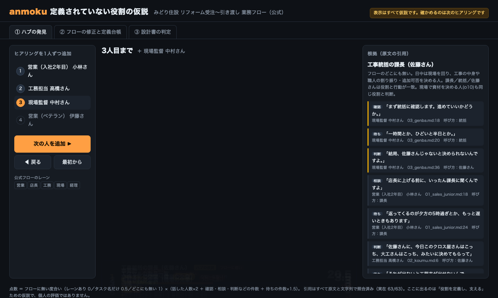
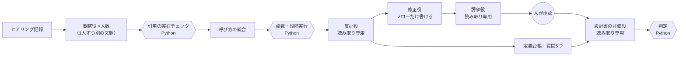

# anmoku（暗黙）

**ヒアリングの語りから、業務フローに定義されていない役割を見つけ、その人の判断を引き継げる形にする。**
見つけた物差し（定義台帳）で、別のAIが作ったエージェント設計書を、作る前に評価する。

> Built with Claude: Japan 2026 の期間中（2026-11-02〜11-08）に新しく作ったツールです。テーマ1「あなたにしかない深さを。」で応募しています。
> 表示はすべて**仮説**です。確かめるのは、人が行う次のヒアリングです。



## なぜ作ったか

業務改善の仕事で、ある会社の業務を現場の語りから業務フローにし、約30件の課題を洗い出しました。
その中で、**フローのどこにも定義されていない1人の統括者**に問い合わせが集中し、返事待ちが全体を遅らせていることが分かりました。
ただ、それに気づいたのは分析の終盤でした。最初のヒアリングの段階で気づけていれば、もっと早く手を打てたはずです。

AIエージェントを作るときも同じことが起きます。フローに無い役割と、その人の頭の中にしかない判断基準は、設計書にも載りません。
anmoku は、それを**ヒアリングの段階で、検証できる根拠つきで**見つけるための道具です。

## 何をするか

| | 入力 | anmoku がすること | 出力 |
|---|---|---|---|
| **関門1：業務フロー** | 複数人のヒアリング記録、業務フロー | 評価＋修正 | ①ハブの仮説（点数の内訳と根拠の引用つき）②次に聞く質問5つ ③「仮」の印つき修正版フロー |
| **物差し** | ヒアリング記録 | 作成・管理 | ④定義台帳（下書き → 回答待ち → 承認済み） |
| **関門2：設計書** | 別のAIが作った設計書・テスト仕様 | 評価だけ（直すのは設計役） | 合格／条件つき合格／差し戻しと、合格の条件 |

デモ用の架空の会社（住宅リフォーム会社「みどり住設」）では、工事統括の佐藤課長がどのレーンにもいません。
語り手は「課長」「佐藤さん」「統括」とばらばらに呼び、経理の山本課長も「課長」と呼ばれます。

### 画面（`anmoku-out/index.html`）

- **① ハブの発見**：「次の人を追加」でヒアリングを1人ずつ足すと、別名がまとまり、点数が跳ね上がる様子が見える。根拠の引用と反証役の確認つき
- **② フローの修正と定義台帳**：修正役 → 評価役 → 人の往復、改善前後のフロー（「仮」の行は黄色の点線）、定義台帳、質問5つ
- **③ 設計書の判定**：1版目は差し戻し、評価結果を設計役に渡して直した2版目は条件つき合格。残る条件は「答えを持つ人の回答待ち」

画面の例（実行結果をそのまま置いたもの）：[`docs/demo/index.html`](docs/demo/index.html)（ダウンロードしてブラウザで開く）

## しくみ

詳しくは [docs/architecture.md](docs/architecture.md)。



原則：

1. **LLM は原文の引用つきの観察だけを書く**。引用は原文と文字列で照合し、無いものは捨てる。点数・照合・判定・図は、同じ入力なら同じ結果になる Python で作る
2. **役割を権限で分ける**。評価役は読み取りツールしか持たず、修正役はフローのファイルにしか書けない。どちらも Hook（`hooks/guard_write.py`）で機械的に止める
3. **評価役には、作った側の会話を渡さない**。フローの評価役には修正版と語りだけ、設計書の評価役には設計書と物差しだけを渡す
4. **検知結果はすべて仮説**。確定させるのは人が行う次のヒアリング。結論は「役割を定義し、支える」方向にそろえる

### 点数（説明できる式）

```
点数 = フローに無い度合い ×（話した人数×2 ＋ 確認・相談・承認・判断・差し戻しの件数 ＋ 待ちの件数×1.5）
```

- フローに無い度合い：レーンがある＝0、タスク名にだけ出てくる＝0.5、どこにも無い＝1
- 「ハブの仮説」と呼ぶのは、フローに無く、**2人以上の語りに出て**、1位の半分以上の点数のものだけ（1人の語りだけなら「候補」）
- 役職名だけの呼び方（「課長」など）は、フローの担当欄との照合に使わない（経理の山本課長に当たってしまうため）

### 設計書の判定（Python で固定）

- 重大が1件でもあれば **差し戻し**
- 中・条件、または承認されていない定義に頼る部分が残るあいだは **条件つき合格** まで
- 承認されていない定義を、未確定と書かずにエージェントが自分で当てはめる作りは重大。未確定と明記して人に回していれば「条件」

## 使い方

必要なもの：[Claude Code](https://claude.com/claude-code)（`claude` コマンド）、[uv](https://docs.astral.sh/uv/)、Python 3.12 以上。

### Claude Code のプラグインとして

```
/plugin install anmoku --marketplace chisuke0309/anmoku
```

（古い Claude Code では `/plugin marketplace add chisuke0309/anmoku` のあと `/plugin install anmoku@anmoku`）

導入後、「このヒアリング記録を anmoku で分析して」のように頼むと、Skill が手順に沿って進めます（候補の確認とフローの承認は、利用者に確かめてから進みます）。

### コマンドとして

```bash
git clone https://github.com/chisuke0309/anmoku && cd anmoku
uv sync

# デモの会社で、関門1 → 定義台帳 → フロー修正 → 設計書の評価 まで
uv run anmoku run evals/scenarios/basic --approve-flow \
  --design agent-design_v1.md agent-design_v2.md --test test-spec_v1.md
open evals/scenarios/basic/anmoku-out/index.html
```

| コマンド | 中身 |
|---|---|
| `anmoku detect <案件>` | 関門1：ハブの検知（1人ずつ段階実行・反証役） |
| `anmoku ledger <案件>` | 定義台帳と、答えを持つ人への質問5つ |
| `anmoku fix <案件>` | 修正役 → 評価役の往復（最大2回） |
| `anmoku approve-flow <案件>` | 人が修正版フローを承認する |
| `anmoku review <案件> <設計書.md> [--test <テスト仕様.md>]` | 関門2：設計書の評価 |
| `anmoku approve <案件> <定義ID> "<定義>"` | 人が回答を確かめた定義を承認済みにする |
| `anmoku view <案件>` | 画面を作り直す |

案件フォルダには `interviews/*.md`（1人1ファイル。名前順がヒアリングの順）と `flow.md`（`| レーン | 担当 | タスク | 備考 |` の表）を置きます。
モデルは既定で `claude-sonnet-5-5`（`--model` か環境変数 `ANMOKU_MODEL` で変更）。

## ツール自身の評価

<!-- EVAL_RESULTS -->

## 期間中に作ったもの

このリポジトリの中身は、すべて 2026-11-02 以降に新しく作ったものです（コミット履歴を参照）。

- Python のパッケージ（`src/anmoku/`）：抽出・引用チェック・別名統合・点数・段階実行・反証役・定義台帳・フロー修正・設計書の評価・画面
- Claude Code のプラグイン（`.claude-plugin/`・`skills/`・`agents/`・`hooks/`）
- 評価用シナリオ2本（`evals/scenarios/`）と、生成・評価のスクリプト（`evals/`）。会社・人物・数値はすべて架空
- テスト（`tests/`）

応募文で触れた、実案件で使った業務改善の Skill は背景として話しているだけで、このリポジトリには含めていません。

## 注意

- 表示はすべて仮説です。人を評価する道具ではありません。「誰が悪いか」ではなく「どの役割が定義されていないか」を見つけ、その人の判断を引き継げる形にするために使ってください
- 評価用シナリオは架空の2本だけです。数字は控えめに受け取ってください
- 本番前チェックの5項目は、公開されているAIエージェント導入のチェックリスト（X のアカウント `@mardehaym` の投稿）を参考に、自分の言葉で絞ったものです

## ライセンス

MIT
