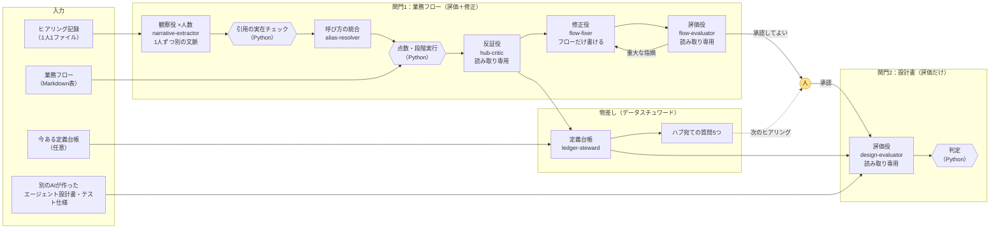

# 構成図

## 全体の流れ

## 役割と権限

| 役割 | 何をするか | 使えるツール | 止め方 |
|---|---|---|---|
| 観察役 `narrative-extractor` | 1人分の語りから、引用つきの観察を JSON で出す | なし | 出力はスキーマで検証し、原文に無い引用は Python が捨てる |
| 統合役 `alias-resolver` | 「統括」「佐藤さん」「課長」が同じ相手かを、観察ごとに根拠つきで提案 | なし | 存在しない観察ID・レーン名は Python が捨てる |
| 反証役 `hub-critic` | 「ハブではない理由」を探す | Read・Grep・Glob | 書き込みは Hook で禁止。反証の引用も原文と照合 |
| 台帳係 `ledger-steward` | 用語・判断基準を定義台帳にまとめ、質問を作る。今ある台帳があれば同じIDを使い、承認済みの定義には直接支える発言だけを根拠にする | なし | 状態（下書き／回答待ち）と質問の順位は Python が決める。承認済みの定義と状態は変えない。定義に無い数・割合・金額を含む発言は、承認済みの根拠から外して「台帳に無い」項目へ出す |
| 修正役 `flow-fixer` | 指摘にもとづき、フローに「仮」の行を足す | Read・Edit | フローのファイル以外への書き込みは Hook で止める |
| 評価役 `flow-evaluator` | 修正版を語りと照らして確認（修正役の経緯は渡さない） | Read・Grep・Glob | 書き込みは Hook で禁止 |
| 評価役 `design-evaluator` | 設計書を、フロー（人が承認した版。承認前なら修正版で、そう明記する）と定義台帳で評価 | Read・Grep・Glob | 書き込みは Hook で禁止。判定は Python |

- 役割ごとの指示文の正本は `agents/*.md`。プラグインのサブエージェントとしても、CLI（`claude -p`）からも同じ指示文を使う
- Hook は `hooks/guard_write.py`。プラグインでは `agent_type`、CLI では環境変数 `ANMOKU_ROLE` で役割を見分ける
- LLM は「原文の引用つきの観察」だけを書く。点数・照合・判定・図は、同じ入力なら同じ結果になる Python で作る
